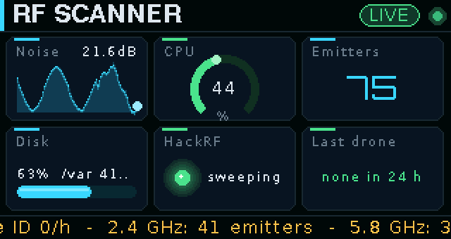
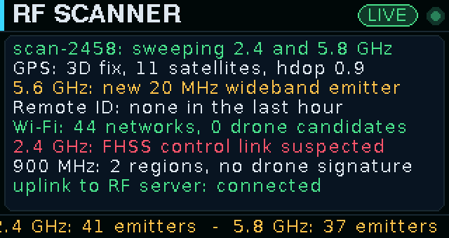
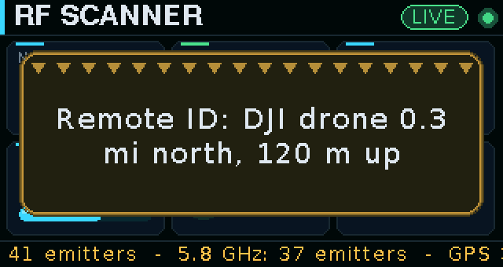

# ESP32-S3 Display Driver

Turn a **LilyGO T-Display-S3** into a plug-and-play USB status display. Plug it into any
Linux box with a USB-C cable (power and data on one cable) and write lines of text to it.
Plain lines scroll in a log. A handful of simple commands draw a dashboard: big numbers,
progress bars, arc gauges, sparklines, status lights, a ticker, and alert overlays.

<p align="center">
  <br>
  <em>Dashboard: up to six tiles, a header with status pill and link heartbeat, and a ticker</em>
</p>

<p align="center">
  
  <br>
  <em>Log page (colour per level) and an alert overlay</em>
</p>

The screenshots come straight from the device: the firmware can send its frame buffer back
over USB (`tdisplay.py shot`).

```bash
echo "TITLE RF SCANNER"           > /dev/ttyACM0
echo "STATUS ok|LIVE"             > /dev/ttyACM0
echo "GAUGE CPU|42|0|100|%"       > /dev/ttyACM0
echo "hello from $(hostname)"     > /dev/ttyACM0     # any other line goes to the log
```

## Features

- **No driver, no setup.** The display is a USB CDC serial device (`/dev/ttyACM0` on Linux).
  It accepts one command per line in plain text, so `echo` works.
- **Widgets:**
  - big number, progress bar, arc gauge (all animate smoothly to new values)
  - sparkline (append one value at a time)
  - key/value text, and a glowing status LED (pulses for warn and crit)
- **Layout:** a header with title, status pill and link heartbeat; a scrolling log with a
  colour per level; a ticker; and an alert overlay with an auto-dismiss timer.
- **Automatic layout.** Up to 6 tiles reflow as they're added. Each label is its own tile,
  and the least recently updated tile is replaced when a seventh arrives. Text fits itself
  to the tile.
- **Flicker-free.** Every frame is drawn into a full-screen frame buffer at about 30 fps.
- **Buttons:**
  - KEY (GPIO14) cycles the page (auto, dashboard, log) and dismisses an alert.
  - BOOT (GPIO0) dims the backlight.
- **Robust unattended:**
  - an 8 KB USB receive buffer and 1 KB lines
  - a task watchdog that reboots a stalled display instead of freezing it
  - USB writes never block when no host is reading
- **Screenshots over USB** (`SHOT`), used for the images above.
- **Python client and library** (`client/tdisplay.py`, standard library plus pyserial,
  Python 3.6+). It has `send`, `pipe`, `demo`, `shot` and `ping`, and an object API for
  your own scripts.

## Hardware

| | |
|---|---|
| Board | LilyGO T-Display-S3, the non-touch or touch version (touch is unused) |
| MCU | ESP32-S3R8 (8 MB PSRAM) with 16 MB flash |
| Display | 1.9" ST7789 IPS, 170 × 320, 8-bit parallel; used in landscape as 320 × 170 |
| USB | USB-C, the ESP32-S3's built-in USB serial/JTAG port (VID:PID `303a:1001`) |
| Buttons | GPIO14 (KEY) and GPIO0 (BOOT) |

No wiring is needed: one USB-C cable powers it and carries the data.

## Repository layout

```
firmware/                 PlatformIO project (Arduino framework, LovyanGFX)
  platformio.ini
  src/main.cpp            display driver, widgets, command parser
client/                   Linux side
  tdisplay.py             CLI + Python library (pyserial)
  requirements.txt
  99-tdisplay.rules       udev rule: /dev/tdisplay symlink, non-root access
  examples/
    sysmon.py             CPU / memory / temperature / disk / network dashboard
    tdisplay-sysmon.service   systemd unit for sysmon.py
    shell.sh              plain-shell usage (echo, journalctl -f | ...)
docs/
  PROTOCOL.md             full command reference
  screenshots/
```

## Quick start

### 1. Flash the firmware (once)

You need [PlatformIO](https://platformio.org/) (`pip install platformio`). The first build
downloads the ESP32 toolchain, about 1 GB.

```bash
cd firmware
pio run -t upload            # builds and flashes; the port is found automatically
```

To upload, the board must be reachable over USB. If an upload doesn't connect, hold
**BOOT**, tap **RST**, then release BOOT, and run the upload again.

### 2. Install the client on the Linux host

```bash
# pyserial: from the distro (python3-pyserial) or pip
sudo dnf install -y python3-pyserial        # or: sudo apt install python3-serial / pip install pyserial
sudo install -m 0755 client/tdisplay.py /usr/local/bin/tdisplay

# optional: a stable /dev/tdisplay name and access without root
sudo install -m 0644 client/99-tdisplay.rules /etc/udev/rules.d/
sudo udevadm control --reload && sudo udevadm trigger
```

### 3. Use it

```bash
tdisplay ping                                   # PONG tdisplay-usb 1.0.0 320x170 uptime=... lines=...
tdisplay demo                                   # a tour of the widgets (Ctrl-C to stop)
tdisplay send "TITLE BUILD SERVER" "STATUS ok|IDLE" "BAR Disk|63"
journalctl -f -o cat | tdisplay pipe            # live log on the display
tdisplay shot screen.png --scale 2              # screenshot
```

From Python:

```python
from tdisplay import TDisplay        # client/tdisplay.py on the path

with TDisplay() as d:                # auto-detects the port (or TDisplay("/dev/tdisplay"))
    d.title("RF SCANNER")
    d.status("ok", "LIVE")
    d.gauge("CPU", 42, unit="%", level="ok")
    d.big("Emitters", 78)
    d.spark_add("Noise", 21.6, " dB")
    d.led("HackRF", "ok", "sweeping")
    d.alert("Remote ID: drone 0.3 mi north", "warn", seconds=10)
    d.log("+ scanner started")
```

The system-monitor example runs as a service:

```bash
sudo install -m 0755 client/examples/sysmon.py /usr/local/bin/tdisplay-sysmon
sudo install -m 0644 client/examples/tdisplay-sysmon.service /etc/systemd/system/
sudo systemctl enable --now tdisplay-sysmon
```

## Command summary

One command per line, terminated by `\n`. Fields are separated by `|`. Levels are `ok`,
`warn`, `crit`, `info` and `off`. Any line that isn't a command goes to the log, and a
leading `!`, `?` or `+` colours it crit, warn or ok.

| Command | Purpose |
|---|---|
| `TITLE text` | header title |
| `STATUS level\|text` | status pill in the header |
| `BIG label\|value\|unit\|level` | big number (or text) tile |
| `BAR label\|value\|max\|text\|level` | progress bar tile |
| `GAUGE label\|value\|min\|max\|unit\|level` | arc gauge tile |
| `SPARK label\|v1,v2,...\|unit\|level` | sparkline tile; `SPARK label\|+v` appends one value |
| `KV label\|value\|level` | key/value tile |
| `LED label\|level\|text` | status light tile |
| `DEL label` · `CLEAR` · `CLS` · `RESET` | remove a tile · all tiles · the log · everything |
| `LOG text` | append to the log (same as a plain line) |
| `ALERT level\|text\|seconds` · `ALERT off` | overlay (0 seconds: until KEY or `ALERT off`) |
| `TICKER text` | scrolling line at the bottom (empty clears it) |
| `PAGE auto\|dash\|log` · `BRIGHT 0-255` · `ROT 1\|3` | page, backlight, rotation |
| `PING` · `HELP` · `SHOT` | version/uptime · command list · screenshot |

See [docs/PROTOCOL.md](docs/PROTOCOL.md) for details, replies and the screenshot format.

## Notes and troubleshooting

- **Board resets when a program opens the port.** The ESP32-S3 USB serial/JTAG port resets
  the chip whenever the host holds RTS high and DTR low. The kernel switches both lines
  together on open and close, so `echo` and `cat` are fine. In your own pyserial code, set
  `dtr=True, rts=False` before `open()`, as `tdisplay.py` does.
- **Permission denied on `/dev/ttyACM0`.** Install the udev rule above, or add your user
  to the `dialout` group.
- **Which port.** The client uses, in this order: `--port` or `TDISPLAY_PORT`, then
  `/dev/tdisplay` (from the udev rule), then the first Espressif USB device (VID `303a`).
  It never guesses a `/dev/ttyACM*` device: other CDC devices, such as a GPS receiver, must
  not receive display commands.
- **Several displays.** Set `TDISPLAY_PORT=/dev/ttyACM1`, or pass `--port`, or give each
  one its own udev symlink by serial number.
- **Nothing on screen after flashing.** Tap RST. A board on battery needs GPIO15 high for
  the LCD power, which the firmware sets.
- **Lines** are cut at 1024 characters, and text is ASCII (other bytes show as spaces).

## Development

```bash
cd firmware
pio run                        # build
pio run -t upload              # flash
pio device monitor             # talk to it interactively (type HELP)
```

The firmware is a single file, `firmware/src/main.cpp`, organised as:
- the panel driver: a LovyanGFX config for the T-Display-S3's 8-bit parallel ST7789
- the palette
- widget state
- drawing
- the command parser
- the main loop

## License

[MIT](LICENSE)
